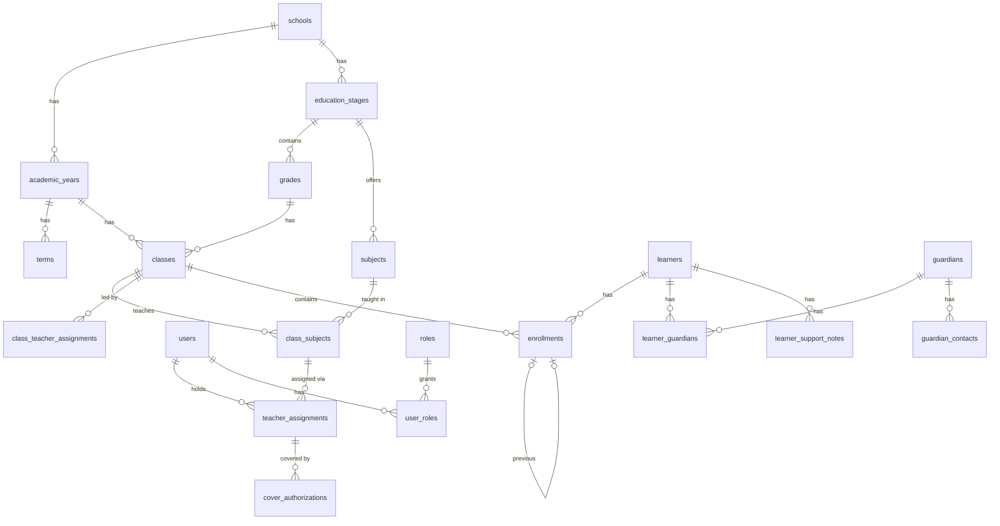

# Database Design — Slice 1: Foundation

**Status:** Approved — decisions D1–D6 accepted as recommended, school code `KLT`\
**Version:** 1.0\
**Date:** 21 October 2026\
**Implements:** Requirements baseline v1.1, §3, §4, §5 (enrollment history), §13–§15\
**Assumed stack:** PostgreSQL 16 with Django 5.2. Every rule below is stated as
a database rule first, so it holds whatever code writes the data.

## 1. Scope

This slice covers the tables every later feature depends on:

| Area | Tables |
|---|---|
| School and structure | `schools`, `school_settings`, `education_stages`, `grades`, `academic_years`, `terms`, `classes`, `subjects`, `class_subjects` |
| Staff and access | `users`, `roles`, `user_roles`, `permissions`, `role_permissions`, `user_permissions`, `user_sessions`, `teacher_assignments`, `class_teacher_assignments`, `cover_authorizations` |
| Learners | `learners`, `learner_number_sequences`, `learner_support_notes`, `guardians`, `guardian_contacts`, `learner_guardians`, `enrollments` |
| Audit | `audit_logs` |

Out of scope here, and designed with their own slices: school calendar,
attendance and absence cases (slice 2); curriculum versions, grading schemes,
assessments and competencies (slice 3); report cards (slice 4); phone
verification codes, communication preferences, contact flags and SMS
(slice 5); promotion/transfer requests and exports (slice 6). This slice
leaves the columns those slices will point at (for example
`enrollments.request_id`) so no foundation table needs reshaping later.

## 2. Conventions

- **Keys.** Every table has a `bigint` identity primary key `id`. Business
  identifiers (learner number, staff number) are separate unique columns and
  never used as foreign keys.
- **School scoping.** Every top-level table carries `school_id` (FK →
  `schools`). Child tables are scoped through their parent. Uniqueness rules
  are per school, e.g. `UNIQUE (school_id, code)`. Version 1 has one school
  row; no multi-school routing is built yet.
- **No routine deletion.** Foreign keys use `ON DELETE RESTRICT` unless stated.
  Records end through a `status` or `end_date`, never `DELETE`. No role is
  granted a delete permission on learner, guardian, enrollment, user or audit
  records.
- **Statuses** are `text` columns with a `CHECK (status IN (...))` constraint,
  not PostgreSQL enums, so adding a value is a simple migration.
- **Timestamps** are `timestamptz`, stored in UTC, shown in Africa/Lusaka.
  `created_at` defaults to `now()`; `updated_at` is set on every update.
- **Date ranges.** "Active over a period" rules use `daterange(start_date,
  end_date, '[]')` with a GiST exclusion constraint (`btree_gist` extension).
  A null `end_date` means open-ended.
- **Extensions:** `btree_gist` (exclusion constraints), `pg_trgm` (likely
  duplicate search), `citext` (case-insensitive usernames and emails).

## 3. Entity overview

## 4. School and academic structure

### `schools`

| Column | Type | Rules |
|---|---|---|
| `id` | bigint | PK |
| `name` | text | required |
| `code` | text | required, `UNIQUE`; short, e.g. `KLT`. Prefixes learner numbers. |
| `address`, `phone`, `email` | text | optional |
| `status` | text | `active` \| `inactive` |
| `created_at` | timestamptz | |

### `school_settings`

One row per school (`school_id` is the PK and FK). Holds `sms_sender_name`
(≤ 11 characters), `logo`, `motto` and other display settings. Settings for
later slices (ranking switch, SMS budget) are added to this table or their own
tables in those slices. Report cards copy the values they display at approval
time, so editing settings never changes an approved report.

### `education_stages`

Separate stages that are never compared directly (baseline §2, §11).

| Column | Type | Rules |
|---|---|---|
| `school_id` | FK | |
| `name` | text | e.g. `Primary`, `Secondary` |
| `sequence` | smallint | display order |
| | | `UNIQUE (school_id, name)` |

### `grades`

| Column | Type | Rules |
|---|---|---|
| `school_id` | FK | |
| `stage_id` | FK → `education_stages` | |
| `name` | text | `Grade 1` … `Grade 7`, `Form 1` … `Form 4` |
| `code` | text | short code used in class names: `1` … `7`, `F1` … `F4` |
| `sequence` | smallint | promotion order across the school, 1–11 |
| `status` | text | `active` \| `retired` |
| | | `UNIQUE (school_id, code)`, `UNIQUE (school_id, sequence)` |

A seed script creates Grades 1–7 (Primary) and Forms 1–4 (Secondary).

### `academic_years`

| Column | Type | Rules |
|---|---|---|
| `school_id` | FK | |
| `name` | text | e.g. `2027`; `UNIQUE (school_id, name)` |
| `start_date`, `end_date` | date | `CHECK (end_date > start_date)` |
| `status` | text | `planned` \| `current` \| `closed` |
| | | at most one `current` per school: partial `UNIQUE (school_id) WHERE status = 'current'` |
| | | no overlapping years: `EXCLUDE USING gist (school_id WITH =, daterange(start_date, end_date, '[]') WITH &&)` |

Making a year current, and closing the previous one, happen in one
transaction and are audited.

### `terms`

| Column | Type | Rules |
|---|---|---|
| `academic_year_id` | FK | |
| `number` | smallint | `CHECK (number BETWEEN 1 AND 3)`; `UNIQUE (academic_year_id, number)` |
| `start_date`, `end_date` | date | `CHECK (end_date > start_date)`; no overlap within a year (exclusion constraint) |

Terms must fall inside their academic year. That spans two tables, so it is
checked by the application on save and covered by tests.

### `classes`

A class exists **for one academic year**: 5A in 2026 and 5A in 2027 are two
rows. See decision D1.

| Column | Type | Rules |
|---|---|---|
| `school_id` | FK | |
| `academic_year_id` | FK | |
| `grade_id` | FK | |
| `stream` | text | e.g. `A`; empty string for a single class |
| `name` | text | generated: grade code + stream, e.g. `5A`, `F2B` |
| `status` | text | `active` \| `closed` |
| | | `UNIQUE (academic_year_id, grade_id, stream)` |
| | | `UNIQUE (id, academic_year_id)` — target for the composite FK from `enrollments` |

### `subjects`

| Column | Type | Rules |
|---|---|---|
| `school_id` | FK | |
| `stage_id` | FK → `education_stages` | |
| `name`, `code` | text | `UNIQUE (school_id, code)` |
| `status` | text | `active` \| `retired` |

### `class_subjects`

Which subjects a class takes this year. This is the unit teacher access is
granted on (baseline §3).

| Column | Type | Rules |
|---|---|---|
| `class_id` | FK | |
| `subject_id` | FK | |
| `status` | text | `active` \| `dropped` |
| | | `UNIQUE (class_id, subject_id)` |

The subject's stage must match the class's grade stage; checked in the
application. Slice 3 adds `curriculum_version_id` here.

## 5. Staff, roles and access

### `users`

Every staff member who signs in. There is no separate staff table; see
decision D2.

| Column | Type | Rules |
|---|---|---|
| `school_id` | FK | |
| `staff_number` | text | `UNIQUE (school_id, staff_number)` |
| `username` | citext | `UNIQUE` |
| `email` | citext | optional; `UNIQUE` where not null |
| `title`, `first_name`, `last_name` | text | |
| `phone` | text | optional, stored as `+260XXXXXXXXX` |
| `password` | text | salted hash (Django default: PBKDF2) |
| `is_active` | boolean | |
| `deactivated_at`, `deactivated_by` | timestamptz, FK → `users` | set together; `CHECK` both null or both set |
| `last_login`, `created_at`, `updated_at` | timestamptz | |

Sign-in accepts staff number, username or email in one field (a custom
authentication backend).

**Deactivation (baseline §3, §15).** In one transaction: set `is_active =
false` and the deactivation columns, delete the user's rows in
`user_sessions` and their server-side sessions, end their open teacher and
class-teacher assignments, revoke open cover authorizations, and write an
audit record. Every request also re-checks `is_active`, so a deactivated user
is refused on their next request even if a session survived.

### Roles and permissions

These map onto Django's built-in auth tables, so no parallel permission
system is built:

| Baseline table | Implemented as |
|---|---|
| `roles` | `auth_group`, one row per role, created by migration |
| `permissions` | `auth_permission` plus custom permissions such as `approve_report_card` |
| `role_permissions` | `auth_group_permissions` |
| `user_roles` | `user_groups` — a user may hold several roles |
| `user_permissions` | `user_user_permissions` (exceptions, e.g. an Academic Administrator authorized to manage shared templates) |

Roles: **System Administrator**, **Headteacher**, **Academic
Administrator**, **Teacher**. Role-to-permission mapping lives in code and is
re-applied on every migration, so a change is reviewed like any other code.

Permissions say *what kind* of record a role may touch. *Which* classes a
teacher may touch comes from `teacher_assignments` and `cover_authorizations`,
checked on the server by one access function that every view and export
uses.

Foundation permissions:

| Action | Sys Admin | Headteacher | Academic Admin | Teacher |
|---|---|---|---|---|
| Manage school structure, years, terms, subjects | yes | view | yes | — |
| Create staff accounts and assign roles | yes | Teacher and Academic Admin only (D6) | — | — |
| Deactivate staff | yes | Teacher and Academic Admin only | — | — |
| Assign teachers, authorize cover | yes | yes | yes | — |
| Register learners, edit learner and guardian details | yes | yes | yes | — |
| View learners | all | all | all | assigned classes only |
| View support notes | yes | yes | — | assigned classes only, if `view_support_notes` granted |
| View audit log | yes | yes | — | — |

### `user_sessions`

Lets administrators see and revoke a user's active sessions.

| Column | Type | Rules |
|---|---|---|
| `user_id` | FK | `ON DELETE CASCADE` |
| `session_key` | text | `UNIQUE`; matches the server-side session |
| `created_at`, `last_seen_at` | timestamptz | |
| `ip_address` | inet | |
| `user_agent` | text | |

### `teacher_assignments`

| Column | Type | Rules |
|---|---|---|
| `school_id` | FK | |
| `teacher_id` | FK → `users` | |
| `class_subject_id` | FK | |
| `assignment_type` | text | `primary` \| `backup` |
| `start_date`, `end_date` | date | `end_date` null = open; `CHECK (end_date IS NULL OR end_date >= start_date)` |
| `status` | text | `active` \| `ended` |
| `assigned_by` | FK → `users` | |
| `created_at` | timestamptz | |
| | | one primary teacher at a time: `EXCLUDE USING gist (class_subject_id WITH =, daterange(start_date, end_date, '[]') WITH &&) WHERE (assignment_type = 'primary' AND status = 'active')` |
| | | no duplicate overlapping assignment of the same teacher: same exclusion on `(class_subject_id, teacher_id)` |

A backup assignment grants **nothing by itself**; it only names who may be
given cover.

### `class_teacher_assignments`

The class teacher receives absence alerts (baseline §6).

| Column | Type | Rules |
|---|---|---|
| `class_id` | FK | |
| `teacher_id` | FK → `users` | |
| `start_date`, `end_date` | date | |
| `assigned_by` | FK → `users` | |
| | | one class teacher at a time: exclusion on `(class_id, daterange)` |

### `cover_authorizations`

| Column | Type | Rules |
|---|---|---|
| `teacher_assignment_id` | FK | the primary assignment being covered |
| `cover_teacher_id` | FK → `users` | must differ from the primary teacher |
| `starts_at`, `ends_at` | timestamptz | `CHECK (ends_at > starts_at)` |
| `duties` | text[] | subset of `attendance`, `assessment_entry`, `competency_entry`; `CHECK (duties <@ ARRAY[...] AND cardinality(duties) > 0)` |
| `reason` | text | required |
| `authorized_by` | FK → `users` | |
| `revoked_at`, `revoked_by` | timestamptz, FK | |
| `created_at` | timestamptz | |

Access is granted only while `now()` is within the window and the record is
not revoked. It expires automatically; no job has to switch it off.

## 6. Learners and guardians

### `learners`

| Column | Type | Rules |
|---|---|---|
| `school_id` | FK | |
| `learner_number` | text | permanent, generated, `UNIQUE (school_id, learner_number)`; never edited |
| `first_name`, `last_name` | text | required |
| `other_names` | text | |
| `date_of_birth` | date | |
| `gender` | text | `F` \| `M` |
| `registration_date` | date | required |
| `previous_school` | text | |
| `status` | text | `active` \| `transferred` \| `withdrawn` \| `completed` |
| `status_changed_at` | timestamptz | |
| `created_by` | FK → `users` | |
| `created_at`, `updated_at` | timestamptz | |

Indexes: `(school_id, last_name, first_name)`; trigram GIN on
`lower(first_name || ' ' || last_name)` for search and duplicate checks.

**Learner number (D4).** Format `{school code}-{6-digit sequence}{check
digit}`, e.g. `KLT-0001234`. The check digit (Luhn, mod 10) catches most
typing mistakes when staff search by number. Numbers come from
`learner_number_sequences (school_id PK, last_value)`, read with `SELECT …
FOR UPDATE` inside the registration transaction, so two simultaneous
registrations cannot get the same number and a rolled-back registration
leaves a harmless gap.

**Likely duplicates (baseline §4).** Before saving, individual and bulk
registration look for an existing learner in the same school where either:

- same date of birth **and** name similarity ≥ 0.6 (trigram), or
- a linked guardian has the same current phone number **and** same first name
  similarity ≥ 0.6.

A match is a warning, not a block. Saving anyway requires a reason, recorded
in the audit log (D5 decides who may do this).

### `learner_support_notes`

Restricted medical and support information (baseline §4).

| Column | Type | Rules |
|---|---|---|
| `learner_id` | FK | |
| `category` | text | `medical` \| `support` |
| `note` | text | keep to what is operationally necessary |
| `created_by` | FK → `users` | |
| `created_at`, `updated_at` | timestamptz | |
| `archived_at`, `archived_by` | timestamptz, FK | archived, not deleted |

Reading a note writes an audit record (`support_note.view`). Notes never
appear in exports unless the export type explicitly includes them and the
user holds `view_support_notes`.

### `guardians`

| Column | Type | Rules |
|---|---|---|
| `school_id` | FK | |
| `full_name` | text | required |
| `email` | citext | optional |
| `status` | text | `active` \| `inactive` |
| `created_at`, `updated_at` | timestamptz | |

### `guardian_contacts`

Phone numbers are kept as history so a changed number never overwrites the
old one (baseline §10).

| Column | Type | Rules |
|---|---|---|
| `guardian_id` | FK | |
| `phone` | text | `+260XXXXXXXXX`; `CHECK (phone ~ '^\+260[579][0-9]{8}$')` |
| `is_current` | boolean | one current number per guardian: partial `UNIQUE (guardian_id) WHERE is_current` |
| `verified_at`, `verified_by`, `verification_method` | timestamptz, FK, text | method: `sms_code` \| `in_person` \| `phone_call` \| `other`; null until verified |
| `created_at`, `retired_at` | timestamptz | |

Changing a number retires the current row and inserts a new unverified one,
so re-verification is automatic. Index on `phone` for lookups.

A phone number is **not** unique across guardians (D3): parents often share
one handset. Registration uses the number to suggest an existing guardian;
staff confirm before linking.

### `learner_guardians`

| Column | Type | Rules |
|---|---|---|
| `learner_id` | FK | |
| `guardian_id` | FK | |
| `relationship` | text | e.g. Mother, Uncle |
| `contact_role` | text | `primary` \| `alternative` \| `none` |
| `receives_results` | boolean | authorized to receive this learner's results |
| `status` | text | `active` \| `removed` |
| `removed_at`, `removed_by`, `removal_reason` | | set when removed; the row is kept |
| `created_at` | timestamptz | |
| | | `UNIQUE (learner_id, guardian_id) WHERE status = 'active'` |
| | | one primary: `UNIQUE (learner_id) WHERE contact_role = 'primary' AND status = 'active'` |
| | | one alternative: `UNIQUE (learner_id) WHERE contact_role = 'alternative' AND status = 'active'` |
| | | `portal_access_status` from §14 is left for the portal phase |

Changing the primary contact demotes the old one first, then promotes the new
one, in one transaction. (A partial unique index cannot be deferred in
PostgreSQL, so the order matters.) The edit screen offers "make primary"
rather than two separate checkboxes, so staff never hit the rule.

Slice 5 decides results recipients from this table: the primary contact if
`receives_results` and their current number is verified, otherwise the
alternative under the same test, otherwise the learner is flagged.

### `enrollments`

| Column | Type | Rules |
|---|---|---|
| `school_id` | FK | |
| `learner_id` | FK | |
| `academic_year_id` | FK | |
| `class_id` | FK | composite `FOREIGN KEY (class_id, academic_year_id) REFERENCES classes (id, academic_year_id)` — a class from another year is impossible |
| `start_date` | date | required |
| `end_date` | date | null while current |
| `status` | text | `active` \| `ended` \| `reversed` |
| `end_reason` | text | `transfer` \| `promotion` \| `repeat` \| `withdrawal` \| `completion` \| `correction`; required when `status = 'ended'` |
| `previous_enrollment_id` | FK → `enrollments` | |
| `request_id` | bigint | FK to promotion/transfer requests, added in slice 6; null for a new registration |
| `reason` | text | |
| `created_by`, `approved_by` | FK → `users` | `approved_by` null for a new registration (no approval needed) |
| `approved_at` | timestamptz | |
| `created_at`, `updated_at` | timestamptz | |
| | | `CHECK (end_date IS NULL OR end_date >= start_date)` |
| | | **no conflicting enrollments:** `EXCLUDE USING gist (learner_id WITH =, daterange(start_date, end_date, '[]') WITH &&) WHERE (status <> 'reversed')` |

The exclusion constraint is the transactional guarantee the baseline asks for
(§5): two overlapping enrollments for one learner cannot both be committed,
even under concurrent requests.

**Transfer** (5A → 5B effective 15 June), in one transaction: set the old
row's `end_date = 14 June`, `status = 'ended'`, `end_reason = 'transfer'`;
insert the new row with `start_date = 15 June` and
`previous_enrollment_id` pointing at the old one. Attendance and results in
later slices reference `enrollment_id`, so records stay with the class they
were taken in.

**Correction** of a mistaken enrollment: mark it `reversed` with a reason
and create the correct one. The reversed row stays for history. Approved
report cards keep their own copy of the class name (slice 4), so they are not
affected.

Index: `(class_id) WHERE status = 'active'` for registers and class lists.

## 7. Audit log

### `audit_logs`

| Column | Type | Rules |
|---|---|---|
| `id` | bigint | PK |
| `school_id` | FK | null only for system-level events |
| `occurred_at` | timestamptz | |
| `actor_id` | FK → `users` | null for scheduled jobs |
| `action` | text | dotted name, e.g. `learner.create`, `enrollment.transfer`, `user.deactivate`, `support_note.view`, `duplicate.override` |
| `object_type`, `object_id` | text, bigint | the record acted on |
| `changes` | jsonb | `{"field": [old, new]}` for updates |
| `reason` | text | required by the application where the baseline asks for one |
| `ip_address` | inet | |
| `request_id` | uuid | groups the records written by one request or bulk operation |

Indexes: `(school_id, occurred_at DESC)`, `(object_type, object_id)`,
`(actor_id, occurred_at DESC)`.

Rules:

- Written in the **same transaction** as the change, so a change cannot
  commit without its audit record.
- **Append-only:** a trigger raises an error on `UPDATE` or `DELETE`, and the
  application's database role has no `UPDATE`/`DELETE` grant on the table.
- Audited in this slice: account creation, role changes, deactivation,
  session revocation, teacher assignments and cover, learner create/update and
  status changes, guardian link changes, contact changes and verification,
  enrollment create/end/reverse, duplicate overrides, support-note views,
  year/term changes.

## 8. Decisions

All six were approved on 21 October 2026 as recommended.

| # | Decision | Agreed | Why |
|---|---|---|---|
| D1 | Classes per academic year, or one permanent class reused each year? (§14 shows no year on `classes`.) | **Per year.** | Each year's 5A has its own pupils, class teacher, subjects and teachers. With permanent classes, every one of those tables needs a year column and the history becomes harder to query. |
| D2 | Separate staff table, or staff = users? | **Staff = users.** | Every Version 1 staff role signs in. One table avoids keeping two records in step. A non-login staff table can be added later if needed. |
| D3 | Must a guardian phone number be unique? | **No.** Suggest a match; staff confirm. | Shared handsets are common. A unique rule would merge two families into one guardian. |
| D4 | Learner number format | **`KLT-0001234`** (school code, sequence, check digit) | Short enough to write on forms, unique across future schools, and typing mistakes are caught. |
| D5 | Who may save a learner despite a duplicate warning? | **Headteacher, System Administrator, Academic Administrator**, with a reason | Overrides are rare and should be accountable. |
| D6 | Which accounts may the Headteacher create? ("within their permitted limits", §3) | **Teacher and Academic Administrator** only | Only a System Administrator should create another System Administrator or Headteacher. |

## 9. Next steps

1. Review this design and settle D1–D6.
2. Build slice 1: project setup, migrations from this design, seed data
   (stages, Grades 1–7, Forms 1–4, roles), registration and import, learner
   profile (personal, guardians, enrollment tabs), user management, audit log.
3. Design slice 2 (calendar, attendance, absence cases) while slice 1 is
   being built.
